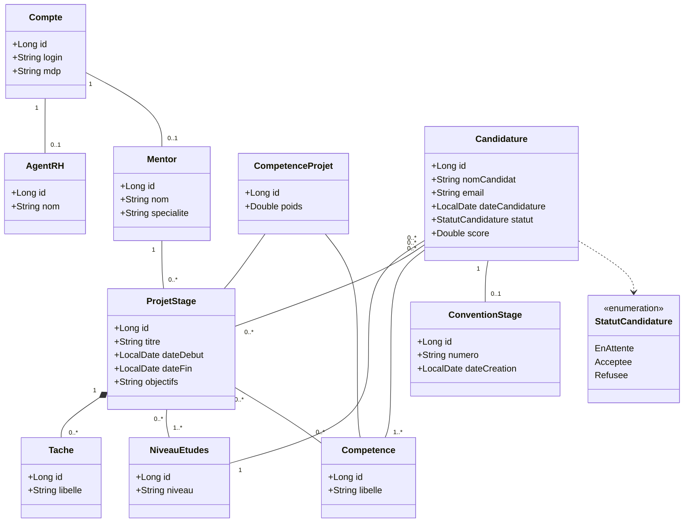
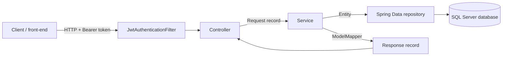
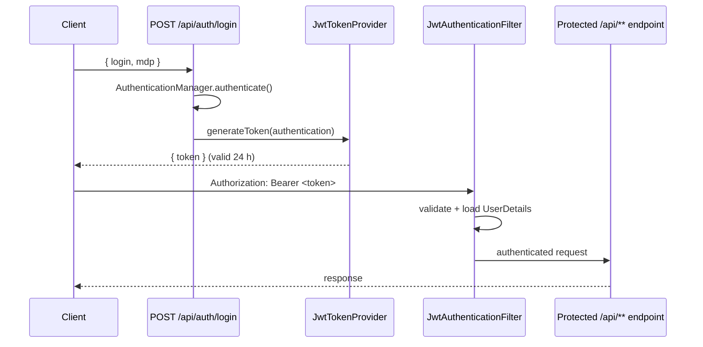

# Gestion des stages — DevTec

Documentation of the internship management platform for **DevTec** (Sfax): a Spring Boot REST backend, its domain model, its UML diagrams, and the architecture that connects them.

> This branch contains documentation only. No application source code was changed.

---

## Table of contents

1. [Project overview](#project-overview)
2. [Requirements](#requirements)
3. [UML diagrams](#uml-diagrams)
   - [Use-case diagram](#use-case-diagram)
   - [Class diagram](#class-diagram)
4. [Architecture](#architecture)
   - [Technology stack](#technology-stack)
   - [Layered backend structure](#layered-backend-structure)
   - [Request flow](#request-flow)
5. [Domain model](#domain-model)
6. [Backend API](#backend-api)
7. [Authentication and security](#authentication-and-security)
8. [Configuration and running locally](#configuration-and-running-locally)
9. [Tests](#tests)
10. [Current limitations and next steps](#current-limitations-and-next-steps)

---

## Project overview

The case study (`GestionStages_TP_GLFinal2026.pdf`) describes DevTec, a software company that regularly hosts interns. Internship intake happens in **January and June**.

Current process:

1. HR asks technical teams to propose internship projects with objectives, desired study levels (`licence`, `mastère`, `ingénieur`) and required skills (e.g. Python, Oracle).
2. Each project is assigned a **mentor** from the technical team.
3. HR publishes the catalogue, collects applications until a deadline, then sorts candidates by study level and by how well their skills match the project requirements.
4. Accepted candidates receive an email and an internship **convention** is prepared, signed by the general director, then by the mentor and the intern (two copies: one for the intern, one for the mentor).
5. The mentor supervises the intern on arrival.

The goal of the application is to centralize this scattered, paper-based process, provide fast access for HR and mentors, and automatically rank applicants.

---

## Requirements

### Functional requirements

- Manage internship projects (title, duration, objectives, required levels and weighted skills).
- Manage mentors, HR agents, education levels, skills, tasks and accounts.
- Submit applications (`Candidature`) and attach candidate skills.
- Filter applications by status, project or education level; accept or refuse an application.
- Automatic sorting of applications based on the candidate's level and the match between candidate skills and the skills required by the project (`score` is currently a derived/transient value).
- Manage internship conventions and their unique identifier.
- Secure access with accounts, roles and a restricted feature set per role.

### Non-functional requirements

- Ergonomic interfaces with clear, simple forms.
- Centralized, quickly searchable data.
- Secured web application and data, with access control by role.
- Unique convention number composed of **sequence–recruitment month (1 or 6)–year**, e.g. `03-6-2026` (3rd intern recruited in June 2026).
- Stateless, token-based authentication for the REST API.

---

## UML diagrams

The original diagrams are stored in [`Architecture/`](Architecture/):

| Diagram | File |
| --- | --- |
| Use cases | [`Use-Case_ Gestion des stages.png`](Architecture/Use-Case_%20Gestion%20des%20stages.png) |
| Classes | [`Class-Diagram_ Gestion des stages.png`](Architecture/Class-Diagram_%20Gestion%20des%20stages.png) |

### Use-case diagram


Actors and use cases, as described by the case study (textual reconstruction of the diagram above):

| Actor | Main use cases |
| --- | --- |
| Administrateur | Create and manage accounts, assign roles |
| Service RH | Propose/publish the catalogue, set the application deadline, receive and examine applications, sort candidates, send acceptance emails, prepare conventions, send them for signature |
| Équipe technique / Mentor | Define project sheets (objectives, levels, skills), supervise the intern, sign the convention |
| Candidat / Stagiaire | Browse the catalogue, submit an application, sign the convention |
| Directeur général | Sign internship conventions |

```mermaid
usecaseDiagram
actor Administrateur
actor "Service RH" as RH
actor Mentor
actor Candidat
actor "Directeur général" as DG
Administrateur --> Gérer les comptes et les rôles
RH --> Gérer les projets de stage
RH --> Publier le catalogue
RH --> Examiner les candidatures
RH --> Trier les candidatures
RH --> Préparer les conventions
RH --> Envoyer les emails d'acceptation
Mentor --> Définir la fiche projet
Mentor --> Superviser le stagiaire
Mentor --> Signer la convention
Candidat --> Consulter le catalogue
Candidat --> Soumettre une candidature
Candidat --> Signer la convention
DG --> Signer la convention
Gérer les projets de stage --> Définir la fiche projet : include
Trier les candidatures --> Examiner les candidatures : include
```

### Class diagram


The diagram was generated with PlantUML and is the direct blueprint of the JPA entities in `backend/src/main/java/com/devtec/gestion_stages/entity/`. The same model is reproduced below in Mermaid:



Key constraints expressed in the source model:

- `Compte` is linked to exactly one side of `Mentor` **or** `AgentRH` — a XOR / totality constraint (a user account represents one person of either type).
- `CompetenceProjet` is an **association class** between `ProjetStage` and `Competence`: it stores the weight (`poids`) of a skill required by a project.
- `ProjetStage` is composed of `Tache` objects (tasks cannot exist without their project).
- `score` on `Candidature` is a derived attribute (`/score`): it is computed for sorting and is not persisted.

---

## Architecture

### Technology stack

| Concern | Choice |
| --- | --- |
| Language / build | Java 25 toolchain, Gradle 9.9.2 (wrapper), `org.springframework.boot` 4.2.0 |
| Web | `spring-boot-starter-webmvc` — REST controllers returning `ResponseEntity` |
| Persistence | `spring-boot-starter-data-jpa`, Spring Data `JpaRepository`, Microsoft SQL Server JDBC driver (H2 for tests) |
| Security | `spring-boot-starter-security`, stateless JWT (jjwt 0.11.5) |
| Mapping | ModelMapper 3.2.0 (entity ↔ response DTO) |
| DTOs | Java `record` types (`*Request` / `*Response`) |
| Boilerplate | Lombok (getters, setters, constructors, `@Slf4j`) |
| Validation | `spring-boot-starter-validation` (`@NotBlank` on some request records) |
| Tests | JUnit 5 / `useJUnitPlatform()` |

### Layered backend structure

All sources live under `backend/src/main/java/com/devtec/gestion_stages/`:

| Package | Role |
| --- | --- |
| `controller/` | 9 REST controllers; map HTTP verbs/paths to service calls, build `ResponseEntity` answers |
| `service/` | Business logic and transaction boundaries (`@Service`, `@Transactional`, `@Slf4j`); includes `CustomUserDetailsService` for Spring Security |
| `repository/` | 10 Spring Data JPA repositories with derived query methods (`findByLogin`, `findByStatut`, `findByProjetStageId`, …) |
| `entity/` (+ `entity/enums/`) | 9 JPA entities mapped to the UML classes, plus `StatutCandidature` |
| `dto/` | 17 immutable request/response records; relationships are expressed as IDs, never as nested entities |
| `security/` | `JwtTokenProvider` (token generation/validation) and `JwtAuthenticationFilter` (Bearer token extraction) |
| `config/` | `SecurityConfig` (filter chain, CORS, password encoder) and `ModelMapperConfig` |
| `exception/` | `ResourceNotFoundException`, `BusinessException` |

The application entry point is `GestionStagesApplication.java` (`@SpringBootApplication`).

### Request flow



1. The filter reads `Authorization: Bearer <token>`, validates it and puts the `UserDetails` into the security context.
2. The controller deserializes the JSON body into a `record`, calls one service method and returns the result (typically `200`, `201` on creation, `204` on deletion, `404` when an ID is unknown).
3. The service resolves referenced IDs to entities, applies business rules and persists through the repository inside a transaction.
4. Entities are converted back to response records with ModelMapper, so JPA entities never leak into the HTTP responses.

---

## Domain model

| Entity / table | Main fields | Relationships |
| --- | --- | --- |
| `Compte` / `comptes` | `login` (unique), `mdp` | One-to-one with `Mentor` and with `AgentRH` (XOR in the UML) |
| `AgentRH` / `agents_rh` | `nom` | One-to-one inverse side with `Compte` |
| `Mentor` / `mentors` | `nom`, `specialite` | One-to-one with `Compte`; one-to-many `ProjetStage` |
| `NiveauEtudes` / `niveaux_etudes` | `niveau` | Many-to-many with `ProjetStage`; one-to-many `Candidature` |
| `ProjetStage` / `projets_stage` | `titre`, `dateDebut`, `dateFin`, `objectifs` | Many-to-one `Mentor`; one-to-many `Tache` and `CompetenceProjet` (cascade, orphan removal); many-to-many levels and candidates |
| `Tache` / `taches` | `libelle` | Many-to-one `ProjetStage` |
| `Competence` / `competences` | `libelle` | Many-to-many `Candidature`; one-to-many `CompetenceProjet` |
| `CompetenceProjet` / `competences_projet` | `poids` | Many-to-one `ProjetStage` and `Competence` (weighted association class) |
| `Candidature` / `candidatures` | `nomCandidat`, `email`, `dateCandidature`, `statut`, transient `score` | Many-to-one project and level; many-to-many skills; one-to-one `ConventionStage` |
| `ConventionStage` / `conventions_stage` | `numero` (unique), `dateCreation` | One-to-one owning side with `Candidature` |

`StatutCandidature` has three values: `EnAttente` (default), `Acceptee`, `Refusee`.

**Business rule — convention identifier.** `numero` follows `sequence-month-year`, with month `1` (January) or `6` (June); `03-6-2026` designates the third intern recruited in June 2026.

---

## Backend API

Base URL: `http://localhost:8080` (default Spring Boot port). All `/api/**` routes require a JWT except `/api/auth/**`.

| Controller / base path | Endpoints |
| --- | --- |
| `AuthController` `/api/auth` | `POST /login`, `POST /register`, `GET /me` |
| `CompteController` `/api/comptes` | `POST /`, `GET /login/{login}`, `GET /{id}`, `DELETE /{id}` |
| `AgentRHController` `/api/agents-rh` | `POST /`, `GET /`, `GET /{id}`, `PUT /{id}`, `DELETE /{id}` |
| `MentorController` `/api/mentors` | `POST /`, `GET /`, `GET /{id}`, `PUT /{id}`, `DELETE /{id}` |
| `NiveauEtudesController` `/api/niveaux-etudes` | `POST /`, `GET /`, `GET /{id}`, `GET /niveau/{niveau}`, `PUT /{id}`, `DELETE /{id}` |
| `CompetenceController` `/api/competences` | `POST /`, `GET /`, `GET /{id}`, `GET /libelle/{libelle}`, `PUT /{id}`, `DELETE /{id}` |
| `ProjetStageController` `/api/projets-stage` | `POST /`, `GET /`, `GET /{id}`, `GET /mentor/{mentorId}`, `PUT /{id}`, `DELETE /{id}` |
| `TacheController` `/api/taches` | `POST /projet/{projetStageId}`, `GET /projet/{projetStageId}`, `GET /{id}`, `PUT /{id}`, `DELETE /{id}` |
| `CandidatureController` `/api/candidatures` | `POST /`, `GET /`, `GET /statut/{statut}`, `GET /projet/{projetStageId}`, `GET /niveau/{niveauEtudesId}`, `GET /{id}`, `PUT /{id}`, `DELETE /{id}`, `PATCH /{id}/accepter`, `PATCH /{id}/refuser` |

Example request bodies (record fields):

```jsonc
// POST /api/auth/register
{ "login": "rh1", "mdp": "secret", "role": "AGENT_RH" }   // role: "MENTOR" or "AGENT_RH"

// POST /api/projets-stage
{
  "titre": "Développement d'une application Mobile",
  "dateDebut": "2026-06-01",
  "dateFin": "2026-09-30",
  "objectifs": "Application mobile intuitive et sécurisée",
  "mentorId": 1,
  "niveauxEtudesIds": [2],
  "competencesProjet": [{ "competenceId": 3, "poids": 0.8 }]
}

// POST /api/candidatures
{
  "nomCandidat": "Alice Martin",
  "email": "alice@example.com",
  "dateCandidature": "2026-05-10",
  "projetStageId": 1,
  "niveauEtudesId": 2,
  "competenceIds": [3, 4]
}
```

---

## Authentication and security

`SecurityConfig` defines a stateless filter chain:

- CORS enabled (default configuration), CSRF disabled, `SessionCreationPolicy.STATELESS`.
- `/api/auth/**` is public; `/api/**` and all other routes require authentication.
- `JwtAuthenticationFilter` runs before `UsernamePasswordAuthenticationFilter`.
- A `BCryptPasswordEncoder` bean and an `AuthenticationManager` are registered.

Login flow:



`app.jwt.expiration-ms=86400000` means a token is valid for 24 hours. `CustomUserDetailsService` currently assigns the single authority `ROLE_USER` to every account; the registration `role` (`MENTOR` / `AGENT_RH`) only creates the matching default `Mentor` or `AgentRH` profile.

---

## Configuration and running locally

Requirements: JDK 25 (or let the Gradle toolchain provision it) and the Gradle wrapper included in the repository.

```powershell
cd backend
.\gradlew.bat bootRun   # start the API on http://localhost:8080
.\gradlew.bat test      # run the test suite
```

`backend/src/main/resources/application.properties` contains:

```properties
spring.application.name=gestion-stages
app.jwt.secret=<replace with a 32+ character secret>
app.jwt.expiration-ms=86400000
```

No datasource URL, credentials or JPA properties are committed. Provide them at runtime (environment variables, command-line arguments or a local profile) for the SQL Server instance, for example `spring.datasource.url`, `spring.datasource.username`, `spring.datasource.password` and `spring.jpa.hibernate.ddl-auto`. Replace the placeholder JWT secret before any real deployment.

---

## Tests

`backend/src/test/java/com/devtec/gestion_stages/GestionStagesApplicationTests.java` contains the initial Spring Boot context test. The Gradle build uses JUnit Platform and H2 as the test database, so unit/integration tests can run without the production SQL Server instance.

---

## Current limitations and next steps

These points are useful starting places for future work on the backend:

- Persist passwords with the already-configured `BCryptPasswordEncoder` instead of storing `mdp` as received.
- Introduce real role authorities (`MENTOR`, `AGENT_RH`, `ADMIN`, …) and method-level authorization; today every authenticated user has `ROLE_USER`.
- Apply `@Valid` on controller request bodies, since `@NotBlank` constraints are currently declared but not triggered.
- Add a global exception handler (`@RestControllerAdvice`) to translate `ResourceNotFoundException` / `BusinessException` into consistent HTTP responses.
- Implement the automatic sorting rule (`Candidature.score` is transient and no ranking algorithm exists yet).
- Expose convention number generation (sequence–month–year) and a `ConventionStage` API; the entity and repository exist but are not wired to a service/controller.
- Move the JWT secret out of the committed properties file into environment configuration.
